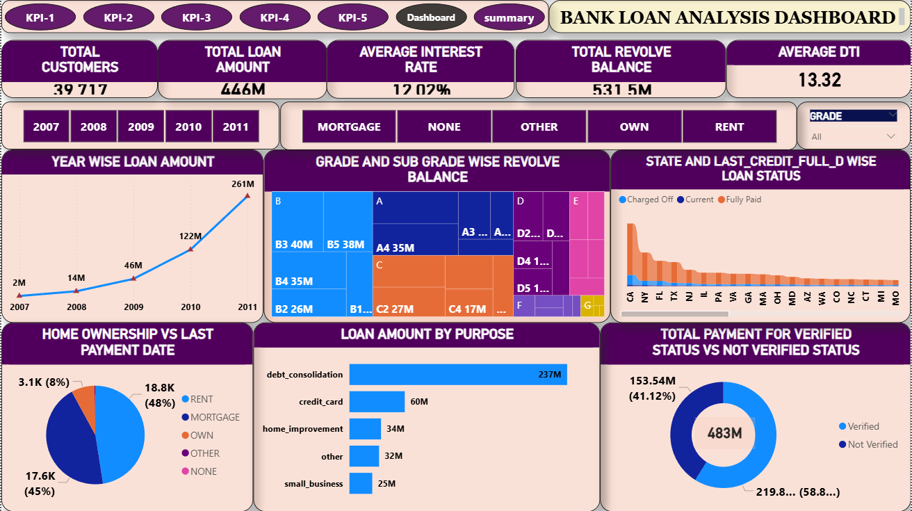

# Bank Loan Analysis Dashboard

Power BI and Excel dashboards analyzing 39,717 loans ($445.6M total loan amount).

## Overview
Merged and cleaned 2 datasets and built interactive dashboards with KPIs and slicers to track loan performance and risk.

## Tools Used
Power BI, Excel, DAX, Data Cleaning

## Key Insights
- 14.2% charged-off rate (5,627 loans)
- Year-wise and month-wise loan trends
- Grade and sub-grade wise revolving balance
- Verified vs non-verified payments
- State-wise loan status
- Home ownership vs last payment date

## Dashboard Screenshot

## Files
- `Bank Loan Analysis Dashboard.pbix` : Power BI dashboard
- `Finance_1.csv`, `Finance_2.xlsx` : loan datasets
- `bank_data_Raw_Data.xlsx` : raw data

## Author
Amit Ghodke | [LinkedIn](https://www.linkedin.com/in/amit-ghodke/) | amitghodke547@gmail.com
